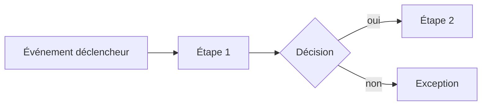

# Spécification fonctionnelle — <Domaine>

## 1. Objet et périmètre

## 2. Acteurs
| Acteur | Description | Droits |
|---|---|---|

## 3. Processus

## 4. Règles de gestion
| ID | Règle | Source | Stories liées |
|---|---|---|---|
| RG-XXX-001 | | | |

## 5. Tables de décision
| Condition 1 | Condition 2 | Résultat |
|---|---|---|

## 6. Données manipulées
| Donnée | Format | Obligatoire | Validation | Sensibilité (RGPD) |
|---|---|---|---|---|

## 7. Cas d'erreur et exceptions
| Cas | Comportement attendu | Message utilisateur |
|---|---|---|

## 8. Questions ouvertes
