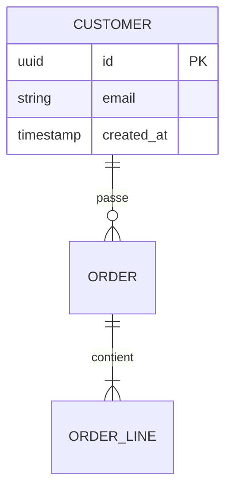

# Modèle de données — <Domaine>

## 1. Modèles d'accès
| ID | Requête / usage | Fréquence | Volumétrie | Latence attendue |
|---|---|---|---|---|

## 2. Modèle (ERD)

## 3. Dictionnaire de données
| Table | Colonne | Type | Null | Description | Classification | Rétention |
|---|---|---|---|---|---|---|

## 4. Index et contraintes
| Table | Index / contrainte | Colonnes | Justification (modèle d'accès) |
|---|---|---|---|

## 5. Migrations
<Outil (EF Core Migrations, Alembic, Flyway/Liquibase, Prisma/Drizzle…), stratégie expand/contract>

## 6. RGPD
- Données personnelles :
- Base légale :
- Procédure d'effacement / anonymisation :
