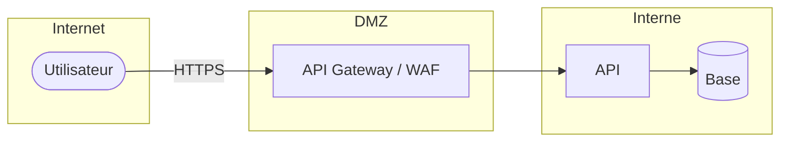

# Modèle de menaces (STRIDE)

## 1. Actifs
| Actif | Description | Confidentialité | Intégrité | Disponibilité |
|---|---|---|---|---|

## 2. Diagramme de flux de données et frontières de confiance

## 3. Menaces
| ID | Élément | STRIDE | Menace | Vraisemblance (1-3) | Impact (1-3) | Risque | Contre-mesure | Propriétaire | Statut |
|---|---|---|---|---|---|---|---|---|---|
| T-01 | | S — Usurpation | | | | | | | |
| T-02 | | T — Altération | | | | | | | |
| T-03 | | R — Répudiation | | | | | | | |
| T-04 | | I — Divulgation | | | | | | | |
| T-05 | | D — Déni de service | | | | | | | |
| T-06 | | E — Élévation de privilèges | | | | | | | |

## 4. Exigences de sécurité dérivées
| ID | Exigence | Réf. ASVS | Vérification |
|---|---|---|---|

## 5. Risques résiduels acceptés
| Risque | Justification | Accepté par |
|---|---|---|
