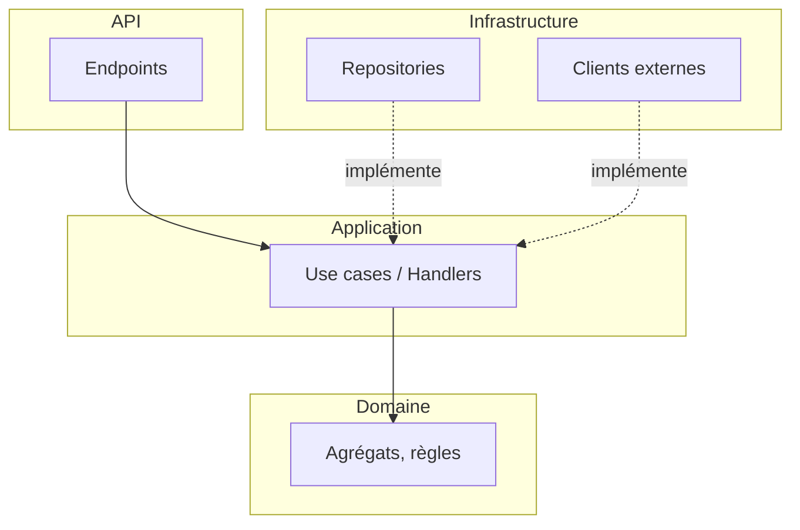

# Conception logicielle — <Composant>

## 1. Responsabilité du composant
<Ce qu'il fait / ce qu'il ne fait pas. Lien vers le SAD.>

## 2. Style retenu
<Couches simples | Clean/Hexagonal | Vertical slices | CQRS…> — justification (ADR-XXXX)

## 3. Modèle du domaine
| Concept | Type (Agrégat / Entité / VO / Service / Événement) | Invariants |
|---|---|---|

## 4. Composants (C4 niveau 3)


## 5. Structure du dépôt
```
<arborescence>
```

## 6. Règles de dépendance
- Domaine → aucune dépendance technique
- Application → Domaine
- Infrastructure / API → Application, Domaine

## 7. Contrats d'API
| Méthode | Route / Opération | Description | Codes retour |
|---|---|---|---|

## 8. Préoccupations transverses
- Validation :
- Gestion d'erreurs (format RFC 9457 Problem Details) :
- Logs / traces :
- Transactions / cohérence :
- Cache :
- Autorisation :
- Configuration :

## 9. Stratégie de tests
| Niveau | Cible | Outils |
|---|---|---|
| Unitaires | Domaine, use cases | |
| Intégration | Repos, API | |
| Architecture | Règles de dépendance | |

## 10. Plan de développement (tâches ordonnées)
1.
