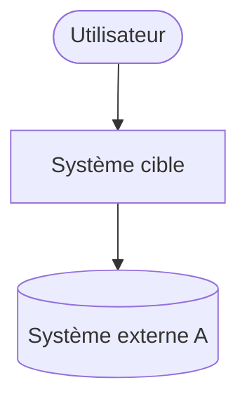
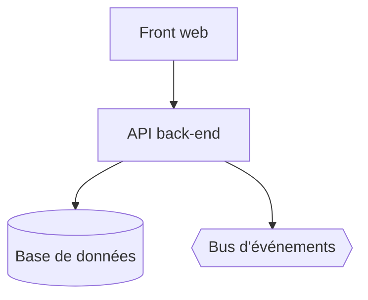

# Dossier d'architecture solution (SAD)

## 1. Contexte et objectifs
<Résumé du besoin, liens vers PRD et charte>

## 2. Drivers d'architecture
| # | Qualité | Scénario mesurable | Priorité |
|---|---|---|---|
| D1 | Performance | | |
| D2 | Disponibilité | | |

## 3. Contraintes
- Techniques :
- Organisationnelles :
- Réglementaires :

## 4. Vue contexte (C4 niveau 1)

## 5. Vue conteneurs (C4 niveau 2)

| Conteneur | Responsabilité | Technologie | Stack (agent) |
|---|---|---|---|

## 6. Intégrations
| Flux | Source → Cible | Mode (sync/async) | Protocole | Contrat | Volumétrie |
|---|---|---|---|---|---|

## 7. Vue déploiement
<Environnements, région(s), haute dispo, renvoi vers le dossier cloud>

## 8. Sécurité (synthèse)
<AuthN/AuthZ, chiffrement, secrets — renvoi vers le modèle de menaces>

## 9. Données (synthèse)
<Stores, classification, rétention — renvoi vers le modèle de données>

## 10. Décisions (ADR)
| ADR | Titre | Statut |
|---|---|---|

## 11. Risques techniques
| Risque | Impact | Mitigation / POC |
|---|---|---|

## 12. Hypothèses et questions ouvertes
