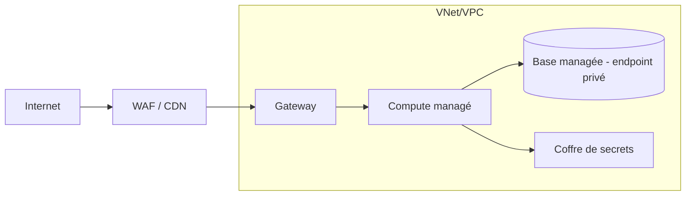

# Architecture cloud — <Projet>

**Fournisseur** : Azure | AWS | GCP  ·  **Région(s)** :  ·  **Souveraineté / contraintes** :

## 1. Organisation
<Comptes / abonnements / projets par environnement, politiques appliquées>

## 2. Architecture de déploiement

## 3. Services retenus
| Composant (SAD) | Service | SKU / taille | HA | Justification |
|---|---|---|---|---|

## 4. Réseau et sécurité
- Segmentation :
- Exposition :
- Identités :

## 5. Résilience
| Exigence | RPO | RTO | Mécanisme | Test de restauration |
|---|---|---|---|---|

## 6. Observabilité
<logs, métriques, traces, alertes — en lien avec le SRE>

## 7. Revue Well-Architected
| Pilier | Conforme | Écarts | Action |
|---|---|---|---|

## 8. Coûts estimés (mensuels)
| Environnement | Estimation | Hypothèses |
|---|---|---|
