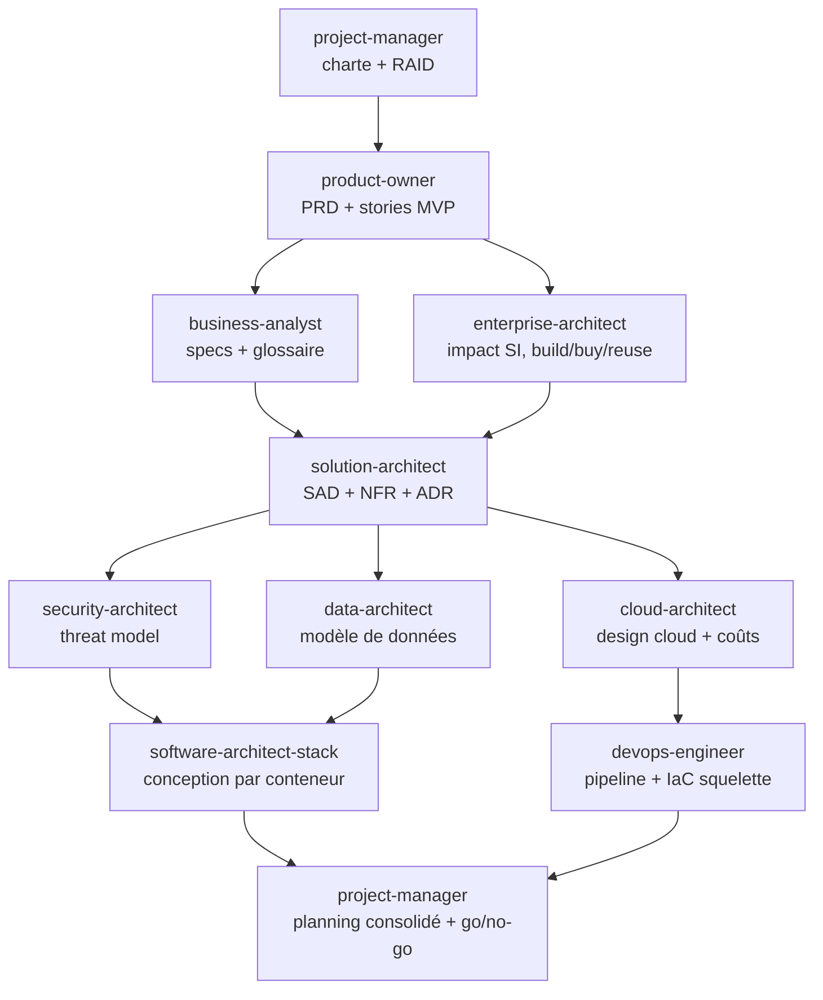

# Workflow 01 — Cadrage d'un nouveau projet

**Déclencheur** : « Je veux lancer un projet / une application qui… »
**Résultat** : charte, PRD, SAD, ADR clés, modèle de menaces, modèle de données, design cloud, conception logicielle, backlog prêt.

## Étapes
| # | Agent(s) | Parallèle ? | Entrée | Sortie |
|---|---|---|---|---|
| 1 | `project-manager` | — | besoin utilisateur | `docs/00-pilotage/charte-projet.md`, `raid.md` |
| 2 | `product-owner` | — | charte | `docs/01-produit/prd.md`, stories MVP |
| 3 | `business-analyst` + `enterprise-architect` | ✅ | PRD | specs, glossaire / note d'impact SI |
| 4 | `solution-architect` | — | tout ce qui précède | SAD, NFR, ADR |
| 5 | `security-architect` + `data-architect` + `cloud-architect` | ✅ | SAD | threat model / modèle de données / design cloud |
| 6 | `software-architect-<stack>` (un par conteneur / stack) | ✅ entre stacks | SAD + 5 | conception logicielle + tâches de dev |
| 7 | `devops-engineer` | ✅ avec 6 | design cloud | conception pipeline, squelette IaC |
| 8 | `project-manager` | — | tous les HANDOFF | planning consolidé, RAID à jour, synthèse go/no-go |

## Points de validation humaine
- Après l'étape 2 (périmètre MVP).
- Après l'étape 4 (architecture et choix technologiques).
- Après l'étape 8 (go pour démarrer le développement).
