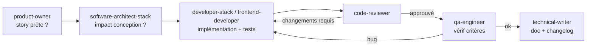

# Workflow 02 — Livraison d'une fonctionnalité

**Déclencheur** : « Implémente la story US-NNN » ou « Ajoute la fonctionnalité X ».
**Résultat** : code fusionnable, testé, relu, documenté.

## Étapes
1. **`product-owner`** — vérifier que la story est « prête » (INVEST, critères Gherkin). Sinon la compléter. *Sauter si la story est déjà prête.*
2. **`software-architect-<stack>`** — l'implémentation touche-t-elle l'architecture (nouveau contrat, nouvelle dépendance, nouveau module) ? Si oui : mise à jour de la conception + ADR. Sinon : brief court au développeur.
3. **`developer-<stack>`** (et/ou **`frontend-developer`** en parallèle si front et back sont découplés par un contrat déjà défini) — implémentation + tests + description de PR.
4. **`code-reviewer`** — revue. Boucle avec l'étape 3 tant qu'il reste du P0/P1 (max. 3 boucles, puis escalade à l'utilisateur).
5. **`qa-engineer`** — vérification des critères d'acceptation, tests E2E si parcours critique.
6. **`technical-writer`** — README / doc API / changelog si le comportement visible change.

## Variante « correctif de bug »
`qa-engineer` (reproduction + test qui échoue) → `developer-<stack>` (correctif) → `code-reviewer` → `qa-engineer` (vérification).
