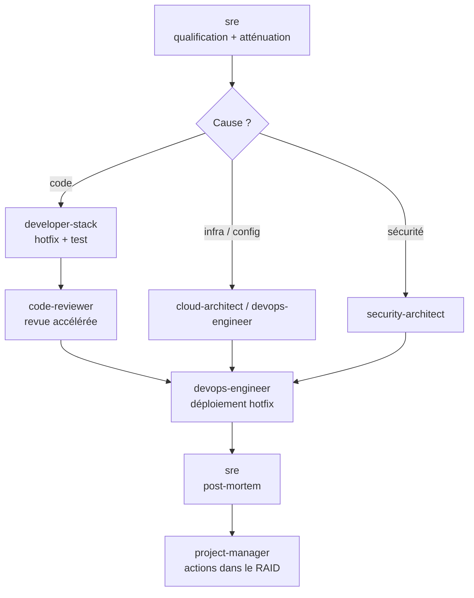

# Workflow 03 — Incident de production

**Déclencheur** : « La prod est en panne », alerte, erreurs en masse, dégradation de performance.
**Principe** : **atténuer d'abord, comprendre ensuite.** Toute action en production exige la confirmation de l'utilisateur.

## Étapes
1. **`sre`** : qualifier la sévérité et l'impact, consulter le runbook, proposer l'atténuation (rollback, feature flag, bascule) → **confirmation utilisateur** → exécuter.
2. Diagnostic de la cause par l'agent compétent (code, infra ou sécurité), en parallèle si la cause est incertaine.
3. Correctif minimal + test de non-régression ; revue accélérée (sécurité et correction uniquement).
4. **`devops-engineer`** : déploiement du correctif via le pipeline (jamais à la main) → **confirmation utilisateur**.
5. **`sre`** : post-mortem sans blâme sous 5 jours ouvrés.
6. **`project-manager`** : actions correctives inscrites au RAID avec propriétaire et échéance.
