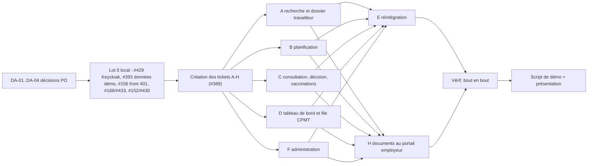

# État des lieux du backlog et du board

> **Proposition à valider par le responsable produit.** Aucune issue, aucun jalon, aucun label et aucun élément du board n'a été modifié. Les commandes de la section 6 ne doivent être lancées qu'après validation.

## 0. Sources et méthode

Extraction en lecture seule le 2026-11-14 :

| Donnée | Commande | Volume |
|---|---|---|
| Issues | `gh issue list --repo rouffou/veilla --state all --limit 1000 --json …` | 329 (161 ouvertes, 168 fermées) |
| Commentaires | `gh api --paginate repos/rouffou/veilla/issues/comments` | 331 |
| Jalons | `gh api repos/rouffou/veilla/milestones?state=all` | 7, tous ouverts, **aucune échéance** (`due_on` vide) |
| Board | `gh project item-list 7 --owner rouffou` · `field-list` | 316 éléments, 13 champs |
| PR | `gh pr list --state all --limit 1000` | 106 (77 fusionnées, 22 fermées, 7 ouvertes) |

Conventions de calcul :
- « hors épiques » exclut le label `type:epic` (23 issues, toutes ouvertes) ;
- % = fermées / total du jalon ;
- les semaines sont des semaines ISO (lundi).

Le cahier des charges (§16.1) définit les Lots 1 à 5. Le **Lot 0, Fondations techniques**, est propre au projet : il porte les prérequis des lots fonctionnels. Le jalon Transverse porte les exigences continues (§16.2 à §16.4).

## 1. État des lieux

### 1.1 Avancement par lot

| Jalon | Ouverts | Fermés | Total | % | Hors épiques : ouverts / fermés / % |
|---|---|---|---|---|---|
| Lot 0 – Fondations techniques | 19 | 77 | 96 | 80 % | 17 / 77 / 82 % |
| Lot 1 – Socle | 16 | 33 | 49 | 67 % | 8 / 33 / 80 % |
| Lot 2 – Surveillance de santé | 28 | 31 | 59 | 53 % | 23 / 31 / 57 % |
| Lot 3 – Réintégration et portails complets | 8 | 23 | 31 | 74 % | 6 / 23 / 79 % |
| Lot 4 – Gestion des risques | 23 | 0 | 23 | 0 % | 22 / 0 / 0 % |
| Lot 5 – Psychosocial, unités de prévention et reporting | 36 | 0 | 36 | 0 % | 33 / 0 / 0 % |
| Transverse – Conformité, recette et mise en service | 28 | 2 | 30 | 7 % | 26 / 2 / 7 % |
| Sans jalon | 3 | 2 | 5 | 40 % | 3 / 2 / 40 % |
| **Total** | **161** | **168** | **329** | **51 %** | 138 / 168 / 55 % |

Constats :
- **Les lots n'ont pas été traités dans l'ordre.** Les Lots 1, 2 et 3 sont avancés à 57-80 % alors que le Lot 0 n'est pas fermé. Exemple : 31 tickets du Lot 2 fermés la semaine S41, contre 9 tickets du Lot 0.
- Aucun ticket des Lots 4 et 5 n'a été démarré : aucune fermeture et aucun commentaire d'avancement, sauf #105 pour sa partie Audit.
- **Aucune épique n'est fermée**, alors que toutes les exigences de six épiques sont fermées (voir 1.4).

#### Lot 0 : les 17 tickets ouverts, classés par dépendance

Ce classement est une analyse du chef de projet à partir des commentaires des tickets.

| Catégorie | Tickets | Nb |
|---|---|---|
| Réalisable en développement, sans dépendance externe | #152 (PR #430 ouverte), #166 (PR #433 ouverte), #196, #203, #393, #396 ; plus la partie front de #156 | 6 + 1 partiel |
| Nécessite Azure (déploiement réel, #282) | #158, #204, #206, #208, #214, #236, #282 | 7 |
| Nécessite une décision ou une validation métier | #165 (informations contractuelles), #401, #404 | 3 |
| #156 | reste la gestion du 401 côté front ; la fédération CSAM et le contexte Entra `c1` dépendent de #282 | (compté ci-dessus) |

**Conséquence** : tant que le premier déploiement Azure (#282) n'est pas fait, le Lot 0 ne peut pas être fermé. Appliquée strictement, la règle « on traite les lots dans l'ordre » bloque alors toute la suite (voir la décision DA-01 du RAID).

### 1.2 Tickets partiellement réalisés

#### a) Audit du Lot 0 (commentaires du 2026-10-24)

Le commentaire « Audit du Lot 0 … partiellement réalisé. Reste à faire » figure sur 18 tickets.

| Ticket | État | Ce qui reste (résumé du commentaire) | Suite donnée |
|---|---|---|---|
| #152 INT-01 | ouvert | schéma OAuth2 OpenAPI, publication APIM, test de contrat, API partenaires | PR #430 ouverte (`Refs`) ; suite #428 |
| #156 NF-01 | ouvert | gestion du 401 `insufficient_user_authentication` côté front ; CSAM, Entra `c1` | PR #431 fusionnée le 2026-11-14 (`Refs`) |
| #158 NF-03 | ouvert | clés en Azure, CMK, TLS PostgreSQL, vérifications réelles | dépend de #282 |
| #165 NF-13 | ouvert | registre livré (PR #397) ; 12 points contractuels à confirmer | décision du responsable produit, puis #282 |
| #166 NF-14 | ouvert | simulateurs imposés, procédure de pseudonymisation | PR #433 ouverte (`Closes #166`) |
| #196 ARC-23 | ouvert | tests de contrat (Pact), seuil de couverture bloquant à 80 % | aucune PR |
| #203 ARC-35 | ouvert | modèles de lecture ou ADR d'écart ; écrans du BFF interne en 501 | cadre posé par la PR #402 ; écrans liés à la démo |
| #204 ARC-40 | ouvert | Entra, CSAM, `Authentication__*` | dépend de #282 |
| #206 ARC-42 | ouvert | APIM par BFF, certificat TLS, publication de `bff-interne` | dépend de #282 |
| #208 ARC-44 | ouvert | HSM, domaine de sécurité, test de rotation | PR #395 (`Refs`) ; suite #396 ; dépend de #282 |
| #214 ARC-52 | ouvert | réplica PostgreSQL, réplication Blob, exercice PRA | dépend de #282 |
| #236 CTR-24 | ouvert | racine `preview`, images `pr-<n>`, OIDC `pull_request` | dépend de #282 |
| #282 Déploiement | ouvert | vérifications ajoutées après l'audit, plus 6 commentaires d'ajouts (2026-10-09 → 2026-11-14) | action manuelle Azure |
| #157 NF-02 | fermé | test de la matrice, revue, rôles Entra | PR #400 ; suites #399 et #401 |
| #182 NF-62 | fermé | alertes, workbook, `alert_email` | PR #382 ; reste reporté dans #282 |
| #194 ARC-21 | fermé | `DelaisRecours`, test d'architecture | PR #403 ; suite #404 |
| #212 ARC-50 | fermé | déploiement progressif, cosign | PR #388 ; reste reporté dans #282 |
| #265 Glossaire | fermé | glossaire, liens, inversion BCE / BCSS | PR #353 |

Les tickets fermés ont tous une PR et, si besoin, un ticket de suite : ils sont cohérents.

#### b) Autres tickets ouverts avec un « Reste » dans les commentaires d'avancement (Lots 1 à 3 et Transverse)

| Ticket | Ce qui reste | Nature du blocage |
|---|---|---|
| #28 AFF-06 | transfert effectif des dossiers de santé (SAN-42) | dépend de #62 |
| #46 SAN-10, #47 SAN-11, #49 SAN-13, #138 DOC-04 | canaux SMS, courrier, recommandé électronique, eBox | prestataires à désigner |
| #48 SAN-12 | claim `personne_id` non émis par le realm Keycloak (2026-10-07) | à revérifier après #323 (fermé) et la PR #429 |
| #53 SAN-23, #59 SAN-34 | valeurs de référence et délais à valider par le département médical | validation métier (#404) |
| #54 SAN-24 | dictée vocale « hors périmètre » | décision : sortir du périmètre ou garder |
| #55 SAN-30 | PDF du formulaire par Documents | développement |
| #57 SAN-32 | prestataire de signature qualifiée à choisir | décision ou prestataire |
| #62 SAN-42 | canal réel (eHealthBox ou équivalent) | externe |
| #64 SAN-44 | validation humaine de la purge, preuve de destruction | développement |
| #68 SAN-60, #72 SAN-64 | courrier au travailleur ; adaptateur eHealth réel | développement ; externe (INT-04) |
| #124 POR-01 | fédération CSAM réelle | externe et Azure (#282) |
| #125 POR-02 | compteurs « bientôt disponibles » (Lots 2, 4, 5) | dépend des lots suivants |
| #129 POR-06 | PDF/A, rapports, attestations (Documents) | développement |
| #132 POR-12 | demandes du travailleur (#323 fermé depuis) | à revérifier, peut-être soldé |
| #155 INT-04 | formats BCE, DIMONA, DmfA, registre national | externe |
| #168 NF-21 | validation veraPDF | outillage |
| #177 NF-50 | audit WCAG 2.1 AA complet | développement et recette |
| #181 NF-61 | écran d'administration dans l'application interne | parcours démo F |
| #260 TSK-DROITS | relation de soin, `IAuditTrail` dans les services sensibles | développement, lié à #401 |
| #369 | rattrapage livré pour Personnes et Affiliés (PR #383) ; autres producteurs à faire | développement |

### 1.3 Tickets bloqués

| Ticket | Bloqué par | Depuis | Effet |
|---|---|---|---|
| #401 [DÉCISION] Écarts de droits §3.1 / §3.3 ↔ code | décision du responsable produit, écart par écart (5 points) | 2026-10-25 | droits de l'infirmier et du CPMT dirigeant dans les écrans de démo ; #260 |
| #404 [VALIDATION MÉTIER] Délais légaux initiaux | département médical | 2026-10-25 | #53, #59 et le délai de copie SAN-43 |
| #385 Incapacités : fin, annulation, doublons | décision métier (source qui fait foi, tolérance sur la date) | 2026-10-25 | parcours E (réintégration) ; sans jalon, absent du board |
| #165 NF-13 | 12 informations contractuelles (DPA, prestataires) | 2026-10-25 | fermeture du Lot 0 |
| #282 Premier déploiement Azure | action manuelle : abonnements, OIDC, runner VNet, Entra, HSM | 2026-09-28 | 7 tickets du Lot 0 (1.1) ; #399 |
| #54, #57 | décision de périmètre ou de prestataire | 2026-10-07 | Lot 2 |

Aucun ticket n'a de label ou de champ « bloqué ». Ces blocages ne se lisent que dans le texte des tickets.

### 1.4 Doublons, chevauchements, tickets obsolètes, tickets sans jalon ou sans label

**Chevauchements** : un même reste à faire est suivi dans plusieurs tickets.

| Sujet | Tickets | Proposition |
|---|---|---|
| Publication APIM (`validate-jwt`, `rate-limit`) | #152, #206, #428 | la garder dans #206 seulement (#428 y renvoie déjà) |
| Fédération CSAM, Entra | #156, #204, #124, #282 | la suivre dans #282 (Azure) et #124 (portail) ; retirer la case des autres tickets |
| Clés, HSM, rotation | #158, #208, #396, #282 | #208 pour le HSM, #396 pour le rechiffrement ; #158 renvoie vers eux |
| PRA, RPO et RTO | #214, #173 | #214 pour l'infrastructure, #173 pour l'exercice et la mesure |
| Archivage et purge | #64, #168, #169 | #64 pour le dossier de santé ; #169 transverse pour les autres données |
| Droits | #260, #401, #399 (suites de #157) | #260 attend #401 |

**Tickets probablement obsolètes**, à vérifier avant fermeture :
- Schémas initiaux #269 (Obligations), #270 (Planification), #271 (Surveillance médicale), #276 (Documents), #277 (Communications). Ils sont ouverts et sans commentaire, alors que chaque service a déjà des migrations EF : Obligations 3, Planification 3, Surveillance médicale 4, Documents 3, Communications 2. Les schémas équivalents du Lot 1 (#266 à #268, #278) et #272 sont fermés.
- Épiques dont toutes les exigences listées sont fermées : #2 Personnes, #3 Postes et risques, #4 Obligations, #11 Documents, #14 Référentiels, #15 Audit.
- #48 et #132 : leur reste dépend de #323, fermé depuis. À revérifier.

**Sans jalon** (5) : #385 (ouvert), #399 (ouvert), #428 (ouvert), #377 (fermé), #386 (fermé).
**Sans aucun label** (2) : #399, #428.
**Sans label `type:*`** (10) : #399, #428 (ouverts) et 8 tickets fermés (#293, #298, #300, #312, #337, #346, #347, #359), qui ont le label `bug`.

**Plan de la démo incomplet** : le commentaire de #389 du 2026-10-25 annonce une vague 1 (A, B, C, D, F) et une vague 2 (E, H, vérification de bout en bout, script, présentation), avec « tickets créés au lancement ». **Aucun de ces tickets n'existe.** Seuls #390, #391, #392 (fermés) et #393 (ouvert) existent. Dans le code, les 8 modules de routes fonctionnels de `app-interne` (admin, affilies, consultation, planification, reintegration, travail, travailleurs, vaccinations) affichent encore `PlaceholderPage`.

### 1.5 Cohérence entre le board et les issues

| Constat | Détail |
|---|---|
| 13 issues absentes du board | #377, #385, #386, #389, #390, #391, #392, #393, #396, #399, #401, #404, #428. Toutes ont été créées après le 2026-10-24 : l'ajout automatique au board ne fonctionne pas ou n'est pas activé. **L'épique démo #389 et ses tickets ne sont pas sur le board.** |
| Statut incohérent | #111 PLA-04 est fermé mais en `Todo` sur le board. |
| `In Progress` à requalifier | #166 (cohérent : PR #433 ouverte) ; #165 (en cours depuis le 2026-10-25, mais le reste attend des informations contractuelles : à passer en « bloqué, décision PO »). |
| « En cours » dans les commentaires mais `Todo` sur le board | #152 (commentaire du 2026-10-25 ; PR #430), #156 (commentaire du 2026-10-25 ; PR #431 fusionnée), #208 (commentaire du 2026-10-25 ; PR #395 fusionnée), #369 (commentaire du 2026-10-24 ; PR #383 fusionnée). |
| Champs absents | Pas de priorité, de taille, de zone, de blocage ni de marqueur démo. Le Status n'a que 3 valeurs (Todo, In Progress, Done). |
| Jalons | Aucune échéance sur les 7 jalons. |

Répartition au board : Done 162, Todo 152, In Progress 2. Croisement avec l'état des issues : (fermée, Done) 162 ; (ouverte, Todo) 151 ; (ouverte, In Progress) 2 ; (fermée, Todo) 1.

## 2. Vitesse et projection

### 2.1 Vitesse constatée (issues fermées par semaine ISO)

| Semaine | Issues créées | Issues fermées | Répartition des fermetures | PR fusionnées (humaines / Dependabot) | Commits sur main |
|---|---|---|---|---|---|
| S40 (28/09) | 279 | 53 | Lot 0 : 50, Lot 1 : 3 | 0 / 1 | 21 |
| S41 (05/10) | 15 | 72 | Lot 2 : 31, Lot 1 : 29, Lot 0 : 9, Lot 3 : 3 | 14 / 10 | 58 |
| S42 (12/10) | 0 | 0 | — | 0 / 0 | 0 |
| S43 (19/10) | 34 | 43 | Lot 3 : 20, Lot 0 : 18, Transverse : 2, sans jalon : 2, Lot 1 : 1 | 35 / 6 | 41 |
| S44 (26/10) | 0 | 0 | — | 0 / 0 | 0 |
| S45 (02/11) | 0 | 0 | — | 0 / 3 | 3 |
| S46 (09/11, jusqu'au 14/11) | 1 | 0 | — | 3 / 5 | 8 |
| **Total** | 329 | 168 | | 52 / 25 | 131 |

Lecture :
- **Les 53 fermetures de S40 sont des fermetures à l'import.** Elles ont eu lieu le 2026-09-28, moins de 4,8 h après la création des issues par `tools/github-backlog`, et ne mesurent pas une capacité de livraison.
- Hors import : **115 fermetures en 7 semaines, soit 16,4 par semaine en moyenne**. Sur les seules semaines actives (S41 et S43), la moyenne est de 57,5 par semaine.
- **Le rythme est en rafales.** Il y a eu 4 semaines sur 7 sans aucune fermeture d'issue. La dernière fermeture date du 2026-10-25. La PR #431, fusionnée le 2026-11-14, est en `Refs` et n'a fermé aucun ticket.
- Contributeur unique : 303 des 331 commentaires sont de `rouffou`, les autres viennent des bots.

### 2.2 Projection par lot

Méthode : nombre de tickets ouverts hors épiques, divisé par la fourchette de vitesse constatée (basse 16,4/semaine, haute 57,5/semaine). **Cette projection est fragile** :
- les tickets sont de taille très hétérogène, et aucun champ « taille » ne permet de pondérer ;
- une partie des tickets ne dépend pas de la vitesse de développement, mais d'Azure, de prestataires ou de décisions.

D'où une deuxième colonne, limitée aux tickets réalisables sans dépendance externe, qui est une analyse du chef de projet (1.1, 1.2).

| Lot | Ouverts hors épiques | Brut (semaines) | Dont réalisables sans dépendance externe | Projection sur ce sous-ensemble (semaines) | Fermeture complète du lot |
|---|---|---|---|---|---|
| Lot 0 | 17 | 0,3 – 1,0 | 6 (+ partie front de #156) | 0,1 – 0,4 | **conditionnée par #282 et par #165, #401, #404** |
| Lot 1 | 8 | 0,1 – 0,5 | 3 (#125, #129, #181, aux restes près) ; #260 attend #401 | < 0,2 | conditionnée par CSAM (#124), les formats (#155) et #401 |
| Lot 2 | 23, dont 5 schémas probablement obsolètes | 0,3 – 1,4 | #55, #64, #127, #128, #167, #169, #48 à revérifier | non chiffrable sans taille | conditionnée par les prestataires (canaux, signature, eHealthBox) et #404 |
| Lot 3 | 6 | 0,1 – 0,4 | #350, #351, #177 | < 0,2 | conditionnée par eHealth (#72) |
| Lot 4 | 22 | 0,4 – 1,3 | 22 | 0,4 – 1,3 | aucun démarrage |
| Lot 5 | 33 | 0,6 – 2,0 | 33 | 0,6 – 2,0 | aucun démarrage |
| Transverse | 26 | 0,5 – 1,6 | — | — | ces exigences continues ne se ferment qu'en mise en service |

**Conclusion** : la vitesse en nombre de tickets ne prédit pas la date de démo. Le travail de la démo (écrans A à H de l'application interne) **n'est pas encore découpé en tickets**, donc il ne peut pas être projeté. Première action : créer ces tickets avec une taille (A-03 du RAID), puis mesurer la vitesse en taille sur 2 semaines.

## 3. Proposition de priorisation

### 3.1 Principe proposé (décision DA-01, à valider)

Il s'agit de respecter la règle des lots dans l'ordre sans la laisser bloquer la démo par Azure.
1. **Scinder le Lot 0** :
   - le **Lot 0** garde ce qui se fait en local ;
   - un nouveau jalon **« Mise en service Azure »** reçoit les tickets qui ne se ferment qu'au premier déploiement réel : #282, #158, #204, #206, #208, #214, #236, #399, et #396 pour la partie retrait des clés.
   - Ce nouveau jalon se traite avec le Transverse, avant toute mise en production. Il ne bloque pas les lots fonctionnels.
2. **Le Lot 0 local est fermé avant de lancer les écrans de démo**, puis les Lots 1, 2 et 3 sont traités dans l'ordre. Dans chaque lot, on ne retient d'abord que les tickets du chemin critique de la démo. Les autres tickets du lot restent dans le jalon, en P2 ou P3.
3. Les Lots 4 et 5 ne démarrent pas avant la démo.

### 3.2 Chemin critique de la démo (#389)



Les écrans B, C et D dépendent de G (#393) pour avoir des données. #393 dépend de #391, fermé : il peut démarrer tout de suite.

### 3.3 Priorités proposées

**P0, bloquant pour la démo**

| Ticket | Lot | Pourquoi |
|---|---|---|
| PR #429 (fix Keycloak local : `sub`, `auth_time`) | Lot 0, sans ticket | les jetons locaux en dépendent ; PR ouverte |
| #393 DÉMO G, données de démo | Lot 0 | aucun parcours n'est démontrable sans données |
| À créer : A, B, C, D, F (#389, vague 1) | Lot 0 (épique démo) | l'application interne n'a que des pages provisoires |
| #156, reste côté front (401 → `acr_values=mfa`) | Lot 0 | sinon la démo ne peut pas passer en mode `Enforce` |
| #401 décision sur les écarts de droits | Lot 0 | conditionne ce que l'infirmier et le CPMT dirigeant voient et font à l'écran |

**P1, avant la démo**

| Ticket | Lot | Pourquoi |
|---|---|---|
| #166 / PR #433 NF-14 | Lot 0 | PR prête ; données de démo pseudonymisées |
| #203 ARC-35 | Lot 0 | les écrans du BFF interne répondent 501 tant que A à D ne sont pas faits ; à fermer avec D (ou ADR d'écart) |
| #404 délais légaux | Lot 0 | valeurs affichées en concertation et recours |
| #55 SAN-30 PDF du formulaire | Lot 2 | parcours C (décision et formulaire) |
| #128 POR-05, #129 POR-06 | Lots 2 et 1 | parcours H (documents au portail employeur) |
| #125 POR-02 | Lot 1 | tableau de bord employeur montré en démo |
| #181 NF-61 (écran d'administration) | Lot 1 | parcours F |
| #351 file de travail CPMT pour les copies | Lot 3 | parcours D |
| #48 SAN-12 (revérifier `personne_id`) | Lot 2 | réservation par le travailleur |
| À créer : E, H, vérification de bout en bout, script, présentation | épique démo | vague 2 |

**P2, à planifier après la démo, dans l'ordre des lots**
- Lot 0 local : #152 / PR #430, #196, #396 (rechiffrement).
- Lot 1 : #260 (après #401), #28.
- Lot 2 : #46, #47, #49, #53, #59, #64, #127, #138, #167, #168, #169.
- Lot 3 : #350, #177, #385 (après décision), #68.
- #428 (API partenaires), #369 (autres producteurs).
- Fermeture, après vérification, des schémas #269, #270, #271, #276, #277 et des épiques #2, #3, #4, #11, #14, #15.

**P3, hors démo ou dépendance externe**
- Le jalon « Mise en service Azure » (DA-01).
- Les tickets en attente d'un prestataire ou d'un organisme : #124, #155, #57, #62, #72, et #54 (dictée vocale).
- Les Lots 4 et 5, et le Transverse (sauf #250 REC-01, à préparer pour la recette).

## 4. Proposition d'organisation du board

### 4.1 Statuts

On garde le champ `Status` natif (Todo, In Progress, Done), utilisé par les automatismes de GitHub (fermeture vers Done). On n'y ajoute pas de valeurs, pour ne pas toucher aux 316 valeurs déjà posées. Le blocage et la revue se lisent par ailleurs :
- **Bloqué** : nouveau champ `Blocage` (ci-dessous) ;
- **En revue** : champ natif « Linked pull requests » non vide.

### 4.2 Champs à créer

| Champ | Type | Valeurs |
|---|---|---|
| Priorité | sélection | P0, P1, P2, P3 |
| Taille | sélection | XS, S, M, L, XL |
| Zone | sélection | standard, médicale, psychosociale, transverse |
| Parcours démo | sélection | A dossier travailleur, B planification, C consultation, D tableau de bord CPMT, E réintégration, F administration, G données, H documents employeur, Transverse démo, Hors démo |
| Blocage | sélection | Aucun, Décision PO, Validation métier, Azure, Prestataire externe |

Pas de champ « Lot » : le champ natif **Milestone** joue déjà ce rôle (un jalon par lot, convention du projet).

### 4.3 Vues (à créer dans l'interface : `gh` ne crée pas de vues)

| Vue | Mise en page | Filtre | Groupement / tri |
|---|---|---|---|
| Par lot | Board | `is:open` | colonnes = Status, groupement = Milestone, tri = Priorité |
| Démo | Table | `-"Parcours démo":"Hors démo" has:"Parcours démo"` | groupement = Parcours démo, tri = Priorité |
| Bloqué | Table | `-Blocage:Aucun has:Blocage is:open` | groupement = Blocage |
| Priorités | Table | `is:open Priorité:P0,P1` | tri = Priorité puis Milestone |
| Incohérences | Table | `is:closed -status:Done` | — |

À activer aussi dans l'interface, sous *Workflows* : « Auto-add to project » (dépôt `rouffou/veilla`, filtre `is:issue`), « Item closed → Done » et « Pull request merged → Done ».

### 4.4 Règles de mise à jour par l'orchestrateur

1. **Création d'un ticket** : vérifier qu'il est au board et renseigner Milestone, labels `type:*` et `svc:*`, Priorité, Taille, Zone, Parcours démo et Blocage (`Aucun` par défaut).
2. **Lancement d'un agent** : commentaire « En cours » (convention existante) et Status = In Progress.
3. **Ouverture d'une PR** : `Closes #n` si le ticket est soldé, sinon `Refs #n`, et un ticket de suite créé dans le même mouvement. Le Status reste In Progress.
4. **Blocage constaté** : renseigner Blocage et ajouter un commentaire qui nomme la décision attendue. Retour à `Aucun` quand la décision est tracée (entrée D-xxx du RAID).
5. **Fusion** : avec `Closes`, passage automatique à Done. Avec `Refs`, retour en Todo, et ce qui reste est noté dans un commentaire.
6. **Contrôle hebdomadaire** : lancer le script de contrôle (6.5) et reporter les écarts dans le RAID.

## 5. Hypothèses

- H1 : le classement « réalisable sans dépendance externe / Azure / décision » (1.1, 2.2) est une analyse des commentaires des tickets, sans vérification du code ticket par ticket.
- H2 : les schémas #269, #270, #271, #276, #277 sont supposés soldés parce que les migrations EF existent dans chaque service. Leur « Définition de terminé » n'a pas été vérifiée.
- H3 : la démo tourne en local (Docker compose), comme l'indique #389. Les tickets qui ne dépendent que d'Azure ne sont donc pas sur le chemin critique.
- H4 : le jalon proposé pour #428 (Lot 1, épique Intégrations #13) et pour #385 (Lot 3, SAN-60) est une proposition.

## 6. Commandes à lancer après validation

> Ne pas lancer avant la validation du responsable produit. Les blocs 6.2 à 6.4 sont indépendants : chacun s'applique seul.

### 6.1 Variables

```bash
P=PVT_kwHOAYm1yM4Bk6iO                       # id du project 7
STATUS=PVTSSF_lAHOAYm1yM4Bk6iOzhjpUYg        # champ Status
DONE=98236657                                # option Done
fid(){ gh project field-list 7 --owner rouffou --format json --jq ".fields[]|select(.name==\"$1\")|.id"; }
oid(){ gh project field-list 7 --owner rouffou --format json --jq ".fields[]|select(.name==\"$1\")|.options[]|select(.name==\"$2\")|.id"; }
iid(){ gh project item-list 7 --owner rouffou --limit 1000 --format json --jq ".items[]|select(.content.number==$1)|.id"; }
set_opt(){ gh project item-edit --id "$(iid "$1")" --project-id "$P" --field-id "$(fid "$2")" --single-select-option-id "$(oid "$2" "$3")"; }
```

### 6.2 Corriger le board

```bash
# Ajouter les 13 issues absentes
for n in 377 385 386 389 390 391 392 393 396 399 401 404 428; do
  gh project item-add 7 --owner rouffou --url "https://github.com/rouffou/veilla/issues/$n"
done
# #111 fermé mais en Todo
gh project item-edit --id PVTI_lAHOAYm1yM4Bk6iOzg9Ja9g --project-id "$P" --field-id "$STATUS" --single-select-option-id "$DONE"
```

### 6.3 Créer les champs

```bash
gh project field-create 7 --owner rouffou --name "Priorité" --data-type SINGLE_SELECT --single-select-options "P0,P1,P2,P3"
gh project field-create 7 --owner rouffou --name "Taille" --data-type SINGLE_SELECT --single-select-options "XS,S,M,L,XL"
gh project field-create 7 --owner rouffou --name "Zone" --data-type SINGLE_SELECT --single-select-options "standard,médicale,psychosociale,transverse"
gh project field-create 7 --owner rouffou --name "Parcours démo" --data-type SINGLE_SELECT --single-select-options "A dossier travailleur,B planification,C consultation,D tableau de bord CPMT,E réintégration,F administration,G données,H documents employeur,Transverse démo,Hors démo"
gh project field-create 7 --owner rouffou --name "Blocage" --data-type SINGLE_SELECT --single-select-options "Aucun,Décision PO,Validation métier,Azure,Prestataire externe"
```

### 6.4 Renseigner priorités, parcours et blocages (après 6.2 et 6.3)

```bash
# P0
for n in 393 401; do set_opt $n "Priorité" P0; done
set_opt 156 "Priorité" P0
# P1
for n in 166 203 404 55 128 129 125 181 351 48; do set_opt $n "Priorité" P1; done
# P2
for n in 152 196 396 260 28 46 47 49 53 59 64 127 138 167 168 169 350 177 385 68 428 369 269 270 271 276 277; do set_opt $n "Priorité" P2; done
# P3 : tickets Azure et externes
for n in 282 158 204 206 208 214 236 399 124 155 57 62 72 54; do set_opt $n "Priorité" P3; done
# Parcours démo
set_opt 393 "Parcours démo" "G données"
for n in 389 156 203; do set_opt $n "Parcours démo" "Transverse démo"; done
set_opt 55 "Parcours démo" "C consultation"
for n in 128 129; do set_opt $n "Parcours démo" "H documents employeur"; done
set_opt 181 "Parcours démo" "F administration"
set_opt 351 "Parcours démo" "D tableau de bord CPMT"
set_opt 385 "Parcours démo" "E réintégration"
set_opt 48 "Parcours démo" "B planification"
# Blocages
for n in 401 165 385 54 57; do set_opt $n "Blocage" "Décision PO"; done
for n in 404 53 59; do set_opt $n "Blocage" "Validation métier"; done
for n in 282 158 204 206 208 214 236 399; do set_opt $n "Blocage" "Azure"; done
for n in 46 47 49 138 62 72 124 155; do set_opt $n "Blocage" "Prestataire externe"; done
# #165 : sortir de In Progress, le blocage est porté par le champ Blocage
gh project item-edit --id PVTI_lAHOAYm1yM4Bk6iOzg9JbcU --project-id "$P" --field-id "$STATUS" --single-select-option-id f75ad846
```

Ensuite : renseigner la Taille et la Zone ticket par ticket, au fil des créations et des lancements (règle 4.4-1). Elles ne sont pas déductibles des données sans estimation.

### 6.5 Jalons et labels (issues : hors board, sous réserve de DA-01 et H4)

```bash
gh issue edit 428 --repo rouffou/veilla --milestone "Lot 1 – Socle" --add-label "type:interoperabilite,svc:integrations"
gh issue edit 385 --repo rouffou/veilla --milestone "Lot 3 – Réintégration et portails complets"
gh issue edit 377 --repo rouffou/veilla --milestone "Lot 0 – Fondations techniques"
gh issue edit 386 --repo rouffou/veilla --milestone "Transverse – Conformité, recette et mise en service"
gh issue edit 399 --repo rouffou/veilla --add-label "type:infrastructure,svc:identite"
# Si DA-01 est acceptée :
gh api repos/rouffou/veilla/milestones -f title="Mise en service Azure" -f description="Vérifications et configurations qui ne se font qu'au premier déploiement Azure réel (#282)."
for n in 282 158 204 206 208 214 236 399; do gh issue edit $n --repo rouffou/veilla --milestone "Mise en service Azure"; done
# Sinon : gh issue edit 399 --repo rouffou/veilla --milestone "Lot 0 – Fondations techniques"
```

### 6.6 Contrôle hebdomadaire de cohérence (lecture seule)

```bash
# Issues fermées mais pas en Done :
comm -12 <(gh project item-list 7 --owner rouffou --limit 1000 --format json --jq '.items[] | select(.status != "Done") | .content.number' | sort) \
         <(gh issue list --repo rouffou/veilla --state closed --limit 1000 --json number --jq '.[].number' | sort)
# Issues ouvertes mais en Done :
comm -12 <(gh project item-list 7 --owner rouffou --limit 1000 --format json --jq '.items[] | select(.status == "Done") | .content.number' | sort) \
         <(gh issue list --repo rouffou/veilla --state open --limit 1000 --json number --jq '.[].number' | sort)
# Issues absentes du board :
comm -13 <(gh project item-list 7 --owner rouffou --limit 1000 --format json --jq '.items[].content.number' | sort) \
         <(gh issue list --repo rouffou/veilla --state all --limit 1000 --json number --jq '.[].number' | sort)
```

## 7. Décisions attendues du responsable produit

Elles sont reprises dans `docs/00-pilotage/raid-log.md` (DA-01 à DA-07) :
1. **DA-01** : scinder le Lot 0 et créer le jalon « Mise en service Azure » ?
2. **DA-02** : valider le chemin critique et les P0 et P1 de la démo, et créer les tickets A à H ?
3. **DA-03** : #401, les 5 écarts de droits.
4. **DA-04** : #404, faire valider les délais par le département médical (ou les accepter pour la démo).
5. **DA-05** : #385, la source qui fait foi et la tolérance sur la date de début.
6. **DA-06** : fermer les 5 schémas et les 6 épiques soldés ?
7. **DA-07** : appliquer l'organisation du board (sections 4 et 6) ?
