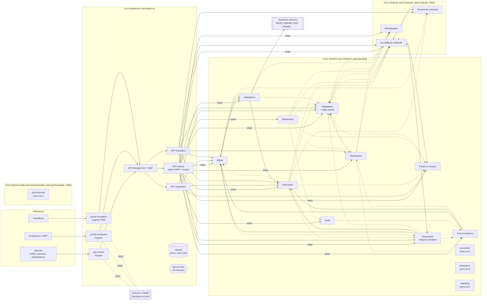

# État des lieux de l'architecture de veilla et recommandations sur la décomposition

> **À l'attention du responsable produit.** Ce document décrit l'existant au 2026-11-14 (commit `c228ee7`), évalue le
> découpage en services et propose une trajectoire. Les décisions attendues sont regroupées au §7. Trois ADR
> accompagnent ce document, au statut « Proposée » : [0014](../adr/0014-trajectoire-decomposition.md),
> [0015](../adr/0015-services-prevus-sans-code.md) et [0016](../adr/0016-placement-lots-4-et-5.md).

## 0. Synthèse

- **Le découpage est sain sur le fond.** Il suit le §14.3 du cahier des charges. Les frontières de zone sont tenues dans
  le code, dans Terraform et par des tests. Aucun service ne référence un autre service : `docs/adr/0002-monorepo.md` et
  `tests/Sepp.Testing.Architecture/CleanArchitectureRules.cs`.
- **Le coût vient surtout de ce qui est déclaré mais vide.** Le catalogue Terraform déploie 21 conteneurs, 18 bases et
  4 serveurs PostgreSQL. Cinq services n'ont pas de code : `identite`, `prevention`, `prestations`, `psychosocial` et
  `reporting`. L'un d'eux, `identite`, crée à lui seul un serveur PostgreSQL dans la zone plateforme.
- **Obligations est le pivot du système.** Il consomme 24 types d'événements sur 9 rubriques et héberge la saga de
  reprise. C'est voulu (ADR 0008), mais c'est le premier point de fragilité.
- **Aucune fusion ni bascule en monolithe modulaire n'est justifiée avant la démo (#389).** La démo tourne en local
  sous Docker Compose : le coût d'exploitation Azure ne la pénalise pas, et toute restructuration ferait courir un
  risque au calendrier sans rien apporter à l'écran.
- **Recommandation.** Garder les 12 services et les 3 BFF. Rationaliser le catalogue de déploiement (ADR 0015). Fixer
  dès maintenant le placement des lots 4 et 5 (ADR 0016). Réévaluer le passage à un hôte unique par zone sur des
  critères mesurables (ADR 0014).

## 1. Sources et périmètre

| Source | Usage |
|---|---|
| `CLAUDE.md` | Conventions du projet, structure, garde-fous |
| `docs/cahier-des-charges-sepp.pdf` | §13 (NF-*), §14 (ARC-*, CTR-*), §14.3 et §14.4 (découpage), §15.4 (événements), §16.1 (lots) |
| `docs/adr/0001` à `0013` | Décisions en vigueur ou proposées |
| `docs/architecture/evenements.md`, `saga-examen-reprise.md`, `rattrapage-projections.md` | Contrats, saga, projections |
| `src/Services/*/src/*Adapters/DependencyInjection.cs` | Gestionnaires d'événements réellement enregistrés |
| `src/Services/*/src/*Adapters/**` (clients HTTP) | Appels synchrones entre services |
| `src/Bff/*/src/*/Aval/DependencyInjection.cs` | Services appelés par chaque BFF |
| `infra/variables.tf`, `infra/main.tf` | Catalogue des services, zones, bases, rubriques, abonnements |
| `deploy/local/compose.yaml` | Environnement local, celui de la démo |
| `.github/workflows/*.yml` | Chaînes CI/CD |
| GitHub `rouffou/veilla` : jalons et épique #389 | Avancement des lots |

## 2. Cartographie

### 2.1 Services, responsabilités et zones

Lignes : lignes non vides des fichiers `.cs` de `src/Services/<X>/src`, migrations EF comprises. C'est un ordre de
grandeur, pas une mesure de complexité.

| Service | Zone | Responsabilité (§14.3, §14.4) | Gestionnaires d'événements | Lignes | Base |
|---|---|---|---|---|---|
| Affiliés | standard | Employeurs, structure, BCE (AFF-01 à 06) | 4 | ~9 800 | oui |
| Personnes | standard | Travailleurs, occupations, affectations, états particuliers (AFF-20 à 24) | **0** | ~5 600 | oui |
| Postes et risques | standard | Postes, risques, règles, listes nominatives (AFF-10 à 14, 30, 31) | 3 | ~5 900 | oui |
| Obligations | standard | Moteur d'échéances (SAN-01 à 04, AFF-32), **saga de reprise** | **24** | ~9 800 | oui |
| Planification | standard | Agendas, rendez-vous, convocations (SAN-10 à 13, PLA-*) | 8 | ~11 100 | oui |
| Documents | standard (+ instance médicale) | Modèles, PDF/A, archivage WORM (DOC-01, DOC-02) | 9 | ~6 900 | oui (×2) |
| Communications | standard | Envoi multicanal, preuves (DOC-03 à 05) | 5 | ~3 000 | oui |
| Intégrations | standard | Couche anti-corruption (INT-*) | 2 | ~3 800 | oui |
| Référentiels | standard | Nomenclatures, paramètres légaux, jours fériés | **0** | ~2 550 | oui |
| Audit | standard (« transverse ») | Journal infalsifiable (NF-04) | 2 | ~2 000 | oui |
| Surveillance médicale | **médicale** | Consultation, décision, dossier, vaccinations (SAN-20 à 71) | 9 | ~17 500 | oui |
| Réintégration | **médicale** | Incapacités, trajets (SAN-60 à 65) | 6 | ~4 900 | oui |
| BFF interne | plateforme | Relais vers 12 services et écrans composites (ADR 0013) | — | — | non |
| BFF employeur | plateforme | Portail employeur (POR-01 à 06) | — | — | non |
| BFF travailleur | plateforme | Portail travailleur (POR-10 à 14) | — | — | non |
| *identite* | plateforme | *Prévu, sans code* | — | 0 | **oui (déclarée)** |
| *prevention* | standard | *Lot 4, sans code* | — | 0 | oui (déclarée) |
| *prestations* | standard | *Lot 5, sans code* | — | 0 | oui (déclarée) |
| *psychosocial* | **psychosociale** | *Lot 5, sans code* | — | 0 | oui (déclarée) |
| *reporting* | standard | *Lot 5, sans code* | — | 0 | oui (déclarée) |

Sources :
- gestionnaires : `AddIntegrationEventHandler<…>` dans `src/Services/*/src/*Adapters/DependencyInjection.cs` ;
- zones et bases : `infra/variables.tf`, l. 131 à 362 ;
- services sans code : `ServicesSansCode` dans `tests/Sepp.BuildingBlocks.Tests/ConfigurationTerraformTests.cs`, l. 176-177.

### 2.2 Dépendances synchrones (HTTP)

| Appelant | Appelé | Motif | Source |
|---|---|---|---|
| Affiliés | Intégrations | Lecture des données BCE après `DonneesBceRecues` | `Sepp.Affilies.Adapters/Externe/IntegrationsHttp.cs` ; `infra/variables.tf` l. 155 |
| Intégrations | Personnes | Flux DIMONA (création des occupations) | `Sepp.Integrations.Adapters/DependencyInjection.cs` ; `infra/variables.tf` l. 291 |
| Documents (standard) | Affiliés, Personnes | Langue des documents (NF-41) | `Sepp.Documents.Adapters/Externe/Adaptateurs.cs` |
| documents-medicale | Surveillance médicale (intra-zone) | Contenu clinique (SAN-41, 43, 50) | `infra/variables.tf` l. 251-253 ; ADR 0009 |
| Communications | Affiliés, Personnes | Coordonnées et langue (DOC-03) | `Sepp.Communications.Adapters/DependencyInjection.cs` |
| BFF employeur | Affiliés, Personnes, Postes et risques, Obligations | Écrans du portail | `src/Bff/Employeur/src/Sepp.Bff.Employeur/Aval/DependencyInjection.cs` |
| BFF travailleur | Planification, Surveillance médicale, Personnes, Affiliés, Obligations, Documents, documents-medicale | Écrans du portail | `src/Bff/Travailleur/src/Sepp.Bff.Travailleur/Aval/DependencyInjection.cs` |
| BFF interne | 12 services (relais YARP) ; Personnes et Affiliés (annuaire) | Application interne | ADR 0013 ; `src/Bff/Interne/src/Sepp.Bff.Interne/Aval/DependencyInjection.cs` |

Entre services, les appels synchrones restent des **lectures**, conformément à ARC-05. Aucun cycle synchrone n'existe :
Affiliés appelle Intégrations, Intégrations appelle Personnes, et Personnes n'appelle personne.

### 2.3 Dépendances asynchrones (événements réellement consommés)

Le tableau est construit à partir des gestionnaires enregistrés, et non des abonnements Terraform, qui sont plus larges.

| Producteur (rubrique) | Consommateurs effectifs |
|---|---|
| affilies | Documents (projection linguistique), Intégrations |
| personnes | Affiliés, Obligations, Postes et risques, Surveillance médicale, Documents |
| integrations | Affiliés, Obligations, Réintégration |
| referentiels | Obligations, Planification, Postes et risques, Surveillance médicale, Réintégration, Audit |
| postes-risques | Obligations, Surveillance médicale |
| obligations | Planification, Surveillance médicale, Réintégration |
| planification | Obligations, Communications, Surveillance médicale, Réintégration |
| communications | Planification |
| surveillance-medicale | Obligations, Postes et risques, Documents (deux instances) |
| reintegration | Obligations |
| documents | Communications, Obligations, Surveillance médicale |
| audit (rubrique partagée) | Audit (tous les services y publient), Communications (bris de glace) |
| bff-employeur | Obligations (`RepriseAnnoncee`, conservé pour rétrocompatibilité, **sans producteur** : ADR 0008) |
| prevention (absent) | Surveillance médicale (`MesurageEnregistreHandler`, déjà écrit) |

En chiffres :
- 18 rubriques déclarées (`publishes_events`, valeur par défaut `true`, dans `infra/variables.tf`) ;
- 66 abonnements déclarés (somme des `subscribes_to`) ;
- 47 couples (contrat, gestionnaire) enregistrés dans le code.

### 2.4 Projections locales

| Service | Projections | Référence |
|---|---|---|
| Obligations | Occupations, affectations, états particuliers, profils de risque, règles, rendez-vous, incapacités, calendrier | ADR 0011 ; `docs/architecture/evenements.md` |
| Planification | Obligations à planifier, paramètres légaux, calendrier | `evenements.md`, section `planification.*` |
| Surveillance médicale | Obligations, affectations, profils de risque, paramètres et calendrier | ADR 0011 |
| Réintégration | Obligations, reprises, absences, paramètres et calendrier | `infra/variables.tf` l. 343-348 |
| Affiliés | Occupations (POR-11) | ADR 0011 |
| Documents | `contexte_linguistique` | ADR 0009 ; migration `20261024175119_ContexteLinguistique.cs` |
| Intégrations | `correspondance_identifiant` (BCE → affilié) | `evenements.md`, section `integrations.donnees-bce-recues` |

Le rattrapage des projections (ADR 0011) n'est livré que pour Personnes et Affiliés. Les autres producteurs sont suivis
par #369.

### 2.5 Sagas

- Une seule saga existe : **la reprise du travail**. C'est l'agrégat `ProcessusReprise`, hébergé dans **Obligations**
  (ADR 0008, migration `20261009051122_ProcessusReprise.cs`), avec des minuteries en base.
- `src/Sagas` ne contient **aucun code de saga** : `src/Sagas/Sagas.slnx` ne référence que les tests de bout en bout
  `tests/Sepp.Sagas.Tests`. La phrase de `CLAUDE.md` « `src/Sagas` : sagas » est donc trompeuse. Correction à apporter à
  la documentation (P3).
- Sagas à venir, selon le modèle de l'ADR 0008 : la réintégration (dans Réintégration, qui porte les délais
  SAN-60 à 65) et la procédure psychosociale formelle (PSY-04, PSY-05, dans Psychosocial).

### 2.6 Diagramme C4, niveau 2 (conteneurs)

Traits pleins : appels HTTP. Pointillés : événements, regroupés par couple producteur → consommateur. Les services en
italique (`[prévu]`) n'ont pas de code.

Les événements transitent tous par Service Bus (le bus de développement PostgreSQL en local, ADR 0004). Le diagramme
trace les liens logiques pour rester lisible.

## 3. Évaluation de la décomposition actuelle

### 3.1 Cohésion et couplage

| # | Constat | Faits | Appréciation |
|---|---|---|---|
| C1 | **Obligations est un pivot à forte entrée.** | 24 gestionnaires sur 9 rubriques (`Sepp.Obligations.Adapters/DependencyInjection.cs` ; `infra/variables.tf` l. 176-181). Il héberge aussi la saga (ADR 0008). | Cohérent avec son rôle : il calcule ce qui est dû à partir de tout le reste. Mais toute évolution des contrats d'amont le touche, et c'est le service le plus exposé aux régressions. **Pas de fusion à prévoir ; à surveiller.** |
| C2 | **Obligations et Planification sont bavards entre eux.** | Obligations → Planification : `ObligationCreee`, `ObligationEchue`, `ObligationCloturee`, `PlanificationUrgenteDemandee`. Planification → Obligations : `RendezVousPlanifie`, `RendezVousAnnule`, `RendezVousReplanifie`, `AbsenceRendezVousConstatee`, `ConvocationEnvoyee`, `ConvocationNonRemise`, `UrgenceNonCouverte`. Soit 11 contrats dans un aller-retour permanent (`evenements.md`). | C'est le couplage le plus fort du système. Il reste **fonctionnel, pas technique** : échéance légale d'un côté, capacité et agenda de l'autre (§5.2, §8). Planification est gros (~11 100 lignes) et a ses propres adaptateurs (outil RH, agendas externes). Une fusion créerait le plus gros service du dépôt pour économiser des contrats déjà écrits et testés. **Candidat à une fusion seulement si le métier change souvent les deux ensemble** (critère de l'ADR 0014). |
| C3 | **La boucle d'envoi des convocations fait trois sauts.** | Planification `ConvocationEmise` → Communications `MessageEnvoye`/`MessageAbandonne` → Planification `ConvocationEnvoyee`/`ConvocationNonRemise` → Obligations (`evenements.md`, dernière section). | Conforme à la séparation DOC-03/SAN-10, et chaque saut est idempotent. La latence et le diagnostic sont plus coûteux, mais OpenTelemetry et `correlationId` (ARC-47) couvrent le diagnostic. Acceptable. |
| C4 | **Personnes ne consomme rien, mais Terraform l'abonne.** | 0 gestionnaire ; `subscribes_to = ["integrations", "affilies"]` (`infra/variables.tf` l. 160), sans filtre. Commentaire en l. 139-141 : « pas encore de consommateur ». | En Azure, ces deux abonnements recevraient tous les messages des rubriques `integrations` et `affilies`, sans que personne ne les retire. Ils s'accumuleraient jusqu'à expiration. *Hypothèse H3 :* la règle KEDA Service Bus de Personnes (`queue_scaled_services`, `infra/main.tf` l. 51 et 447) verrait la file toujours pleine et maintiendrait Personnes au maximum de répliques (10). **P1 à vérifier** par `cloud-architect`. |
| C5 | **Affiliés et Personnes dépendent l'un de l'autre.** | Affiliés projette les occupations de Personnes. Documents et Communications lisent les deux. Intégrations écrit dans Personnes et lit les affiliés. | Couplage modéré, sans cycle synchrone. Le §14.3 les sépare et Personnes porte le NISS chiffré avec son index aveugle (ADR 0012) : la séparation **réduit la surface d'exposition du NISS**. À garder. |
| C6 | **Des services petits mais pas anémiques.** | Audit ~2 000 lignes, Référentiels ~2 550, Communications ~3 000. | Chacun a une responsabilité nette, souvent réglementaire : journal infalsifiable NF-04, règles légales ARC-21, preuves d'envoi DOC-05. Audit gagne même à rester isolé : déclencheurs d'ajout seul et identité sans DDL (ADR 0010). **Aucun n'est anémique.** |
| C7 | **Le code du compte technique est dupliqué.** | `JetonTechniqueHandler` existe dans Affiliés, Documents et Communications (`Externe/IntegrationsHttp.cs`, `Externe/CompteTechnique.cs`, `Annuaire/CompteTechnique.cs`). Intégrations a son propre client. | Duplication technique, sans rapport avec le découpage. À factoriser dans le socle (P3, `software-architect-dotnet`). |
| C8 | **Une rubrique BFF sans producteur.** | `bff-employeur` et `bff-travailleur` publient par défaut (`publishes_events` vaut `true`), alors que les BFF n'ont ni base ni outbox (ADR 0008). Prévention et Psychosocial sont pourtant abonnés à ces rubriques (`infra/variables.tf` l. 194 et 358). | Le plan des lots 4 et 5 repose sur une publication par les BFF, que l'ADR 0008 a écartée pour la reprise. **À corriger avant d'écrire Prévention et Psychosocial** (ADR 0016). |

### 3.2 Frontières de zone (ARC-04, ARC-06)

| # | Constat | Faits | Appréciation |
|---|---|---|---|
| Z1 | **L'isolement par zone est tenu par l'infrastructure.** | Par zone : un environnement Container Apps, un sous-réseau, un groupe de ressources, un coffre, un serveur PostgreSQL et un stockage WORM (`infra/main.tf` l. 290-428). Une validation Terraform refuse qu'un service lise le coffre d'une autre zone (`infra/variables.tf` l. 432). Une clé racine par service (ADR 0012). | Conforme à ARC-04, CTR-10, NF-03 et ARC-44 (HSM dans les zones sensibles). |
| Z2 | **Les événements sont contrôlés.** | Seuls des identifiants, dates et catégories y circulent, ce que vérifie `tests/Sepp.Contracts.Tests/ContractRulesTests.cs`. L'état particulier est générique et son abonnement est réservé à Obligations (`infra/variables.tf` l. 396). | Conforme à ARC-06. |
| Z3 | **Documents est déployé par zone.** | ADR 0009 : `documents-medicale` génère au plus près des données ; la langue vient d'une projection. | C'est la bonne réponse : un seul contexte délimité, plusieurs déploiements. Le même modèle s'appliquera à la zone psychosociale. |
| Z4 | **Des catégories sensibles en zone standard.** | `PROTECTION_MATERNITE`, `CONSULTATION_SPONTANEE` et `VISITE_PRE_REPRISE` sont stockées par Obligations et Planification (zone standard). Le catalogue note qu'elles « révèlent une démarche ou un état du travailleur » (`evenements.md`, section `obligations.*`). | Compromis documenté, conforme à la lettre d'ARC-06 (ce sont des catégories). Il reste un point d'attention RGPD (art. 9) : le filtrage est fait à l'affichage, côté portail employeur. **À faire confirmer par `security-architect` et le DPO.** |
| Z5 | **Les BFF de la plateforme atteignent toutes les zones.** | `allowed_source_prefixes` admet `cae-platform` dans chaque zone (`infra/main.tf` l. 67-70). `bff_environment` donne l'adresse de **tous** les services à **tous** les BFF (l. 194), y compris `psychosocial` au BFF employeur. Le BFF interne relaie Surveillance médicale et Réintégration (ADR 0013). | Le passage par la plateforme est voulu : c'est le canal de l'utilisateur, et chaque service revalide le jeton (ARC-40, ARC-41). En revanche, la **liste des services joignables par BFF n'est pas limitée** côté infrastructure. Moindre privilège à resserrer : chaque BFF ne devrait recevoir que les adresses qu'il utilise (P2, `cloud-architect`). |
| Z6 | **Le journal d'accès psychosocial passerait par la zone standard.** | Rubrique `audit` partagée, service Audit en zone standard. Les traces portent `UtilisateurId`, `ObjetType`, `ObjetId` et `Motif` en texte libre (`evenements.md`, en-tête). PSY-20 exige un « journal d'accès consultable par le CPAP dirigeant ». | Une trace « tel utilisateur a lu tel dossier psychosocial » révèle **l'existence** d'un dossier psychosocial pour une personne, et elle serait stockée en zone standard. *Hypothèse H5 :* cela pourrait être jugé contraire à l'esprit de PSY-20 et d'ARC-06. **Question pour `security-architect`** (ADR 0016, point 4). |

### 3.3 Coût opérationnel

Décompte tiré de `infra/variables.tf` et `infra/main.tf`, pour **un** environnement Azure. Il y a cinq environnements
(CTR-22, `infra/environments/*`).

| Élément | Avec le catalogue actuel | Dont lié aux 5 services sans code | Source |
|---|---|---|---|
| Container Apps | 21 (12 services, documents-medicale, 3 BFF, 5 prévus) | 5 | `module "container_app"`, `for_each = var.services` |
| Bases PostgreSQL | 18 | 5 | `database = true` |
| Serveurs PostgreSQL (un par zone dotée d'une base) | 4 (plateforme, standard, médicale, psychosociale) | **2** : plateforme (identite seul) et psychosociale (psychosocial seul) | `local.db_zones`, `module "postgres"` |
| Jobs de migration et identités de migration | 18 + 18 | 5 + 5 | `module "migration_job"` ; ADR 0010 |
| Rubriques Service Bus | 18 | 5 (dont `identite`, sans usage) | `local.topics` |
| Abonnements Service Bus | 66 | 22 (abonnements *des* services prévus) | `local.subscriptions` |
| Solutions .NET | 18 | 0 | `**/*.slnx` |
| Projets .NET (`src/`) | 110 | 0 | `*.csproj` |
| Workflows GitHub Actions | 8, construits en **matrice** (un job par solution et par image) | 0 | `.github/workflows/` |
| Conteneurs locaux (`compose.yaml`) | 21 : postgres, keycloak, otel, 12 services, 3 BFF, 3 fronts ; plus documents-medicale avec le profil `par-zone` | 0 | `deploy/local/compose.yaml` |

Analyse :

- **CI/CD.** Les « pipelines par service » (CTR-20) sont des jobs de matrice dans 8 workflows partagés, pas des
  pipelines distincts. Leur coût de maintenance est faible. Ce n'est pas un argument de fusion.
- **Postes réellement coûteux.** En Azure :
  - les serveurs PostgreSQL : 4 serveurs Flexible par environnement, dont un **pour un service qui n'existera
    probablement pas** (`identite`, §4) ;
  - les répliques minimales en production : 2 par Container App (CTR-14, `infra/main.tf` l. 443), soit au moins
    42 répliques avec le catalogue actuel, contre 32 sans les services vides ;
  - l'amorçage manuel des rôles PostgreSQL : une fois par base (ADR 0010, point 4), donc 18 fois par environnement.
- **Taille de l'équipe.** *Hypothèse H1 :* un responsable produit et une équipe d'agents IA pilotés par une
  orchestration (`CLAUDE.md`, « Règles de travail » et équipe d'agents). La CI absorbe bien le nombre de services, car
  tout est généré et vérifié par test. En revanche, l'**exploitation** (amorçage des rôles, secrets `--deks--`,
  rotation, procédures de `infra/README.md`) croît linéairement avec le nombre de services et d'environnements, et elle
  repose sur des humains. C'est le vrai plafond.
- **Démo.** Elle tourne sous Docker Compose (#389). Son coût est la mémoire du poste : environ 21 conteneurs, dont
  16 processus .NET. *Hypothèse H2 :* c'est supportable sur un poste de démonstration de 16 Go ou plus. Non mesuré :
  à faire mesurer par `devops-engineer` (`docker stats`).

### 3.4 Services prévus mais vides

| Service | Constat | Recommandation |
|---|---|---|
| `identite` | Aucun code. L'ADR 0005 confie l'identité à Entra ID, CSAM et Keycloak, et l'autorisation au socle (`Security.cs`, matrice des droits). NF-01 est déjà implémentée dans le socle (commit `c228ee7`, `docs/securite/authentification-forte.md`). Le catalogue lui donne pourtant une base, un serveur PostgreSQL de plateforme et une rubrique. | **Retirer du catalogue.** Le §14.4 (« Identité et autorisation : NF-01, NF-02 ») est couvert par le fournisseur d'identité et le socle. Un service ne serait justifié que pour la délégation des mandats employeur (POR-01) si CSAM ne la fournit pas : *hypothèse H4*, à confirmer. ADR 0015. |
| `prevention` | Lot 4 (23 tickets, jalon à 0 %). Surveillance médicale a déjà un gestionnaire `MesurageEnregistre`. | Garder au catalogue, **désactivé** jusqu'au lot 4. ADR 0015 et 0016. |
| `prestations` | Lot 5. Il n'est pas consommé par la saga de reprise (`saga-examen-reprise.md`, étape 6 « hors lot »). | Désactivé jusqu'au lot 5. |
| `psychosocial` | Lot 5. C'est le seul occupant de la zone psychosociale : un serveur PostgreSQL et un environnement Container Apps rien que pour lui. | Désactivé jusqu'au lot 5. L'environnement de zone et le coffre peuvent rester, car ils coûtent peu à vide. Le serveur PostgreSQL doit suivre l'activation (ADR 0015). |
| `reporting` | Lot 5. Abonné à 9 rubriques, sans gestionnaire. | Désactivé jusqu'au lot 5. Ses abonnements seront recréés à l'activation, puis remplis par le rattrapage (ADR 0011). |

*Hypothèse H6 :* avec `deploy_container_apps = true` (valeur par défaut, `infra/variables.tf` l. 448-452), Terraform
tenterait de créer les Container Apps des 5 services vides avec une image `sepp/<service>:<tag>` que
`service-images.yml` ne construit pas. L'`apply` échouerait ou laisserait des révisions en échec. Non vérifié en Azure.

### 3.5 Lots 4 et 5 : où placer les capacités ?

Constat de départ : le §14.3 et le §14.4 fixent déjà un propriétaire pour chaque exigence (ARC-09), et le backlog suit
ce découpage (étiquettes `svc:prevention`, `svc:psychosocial`, `svc:prestations` et `svc:reporting` sur les jalons
Lot 4 et Lot 5). Rien dans le code ne contredit ce placement. Les choix restants sont détaillés dans l'ADR 0016 :

| Capacité | Placement recommandé | Point d'attention |
|---|---|---|
| RIS-*, SEC-*, ERG-*, HYG-* (lot 4) | **Prevention**, zone standard, un seul service | HYG-06 : l'exposition part par `MesurageEnregistre` (déjà consommé par Surveillance médicale). ERG-02 (#88, étiqueté `zone:medicale`) : la recommandation médicale reste dans Réintégration ou Surveillance médicale ; Prevention ne reçoit qu'une demande codée. |
| Plan d'action (RIS-05), alimenté aussi par PSY-12 | **Prevention** (propriétaire), alimenté par `MesurePreventionCreee` | Psychosocial publie des mesures **collectives et anonymes** uniquement (PSY-11). |
| Demandes des portails (RIS-01, PRE-06, PSY-01, questionnaires PSY-10) | **Appel synchrone** BFF → service propriétaire, qui publie par son outbox | Même modèle que la reprise (ADR 0008). On ne publie plus depuis un BFF. |
| Mode hors ligne (NF-34, RIS-03) | Front PWA, avec une API de synchronisation dans **le service propriétaire de la donnée** | Si le hors-ligne s'étend aux consultations des unités mobiles (données médicales), la synchronisation doit se faire en zone médicale. **Question au responsable produit.** |
| PSY-* (lot 5) | **Psychosocial**, zone psychosociale ; saga de la procédure formelle dans ce service (ADR 0008) ; `documents-psychosociale` dès le premier document (ADR 0009) | Journal d'accès PSY-20 : voir Z6. |
| PRE-* (lot 5) | **Prestations**, zone standard | Consomme `ExamenCloture`, les clôtures de Prevention et de Psychosocial, et `TrajetTermine`. L'export de facturation (PRE-07) passe par Intégrations. |
| REP-* (lot 5) | **Reporting**, zone standard : projections alimentées par événements et rattrapées par instantanés (ADR 0011) ; entrepôt REP-21 par job Container Apps | Recouvrement avec les écrans composites « tableau de bord » du BFF interne (ADR 0013) : le BFF compose l'écran opérationnel en temps réel, Reporting porte les indicateurs consolidés et légaux. REP-03 n'a besoin que de catégories et de volumes (ARC-06). |

## 4. Options de décomposition

Critères d'évaluation : bénéfices, risques, coût de migration, impact sur la sécurité par zone et impact sur la démo
(#389). Les coûts sont des ordres de grandeur (*hypothèse H7* : estimation d'architecte, à affiner par
`software-architect-dotnet`).

| Option | Bénéfices | Risques | Coût de migration | Sécurité par zone | Démo #389 |
|---|---|---|---|---|---|
| **A. Statu quo** (12 services, catalogue inchangé) | Aucun travail. Conforme à ARC-01 et au §14.3. | Coût Azure des 5 services vides. Abonnements morts (C4). `apply` douteux (H6). | Nul | Inchangée (bonne) | Neutre |
| **B. Statu quo rationalisé** (12 services ; services vides retirés ou désactivés ; `identite` abandonné ; abonnements alignés sur les gestionnaires) | –5 Container Apps, –5 bases, –2 serveurs PostgreSQL et –22 abonnements par environnement tant que les lots 4 et 5 ne sont pas commencés. Supprime le risque C4. Reste conforme au cahier des charges. | Il faut réactiver proprement chaque service à son lot (procédure à écrire). | Faible : Terraform et un test (`ServicesSansCode`). Environ 1 à 2 jours. | Inchangée. Moins de surface exposée. | Neutre : la démo est locale, et `compose.yaml` ne contient déjà pas ces services. |
| **C1. Fusion Obligations + Planification** | –11 contrats d'aller-retour, transactions locales, saga plus simple. | Crée le plus gros service (~21 000 lignes) et mélange l'échéance légale avec la logistique (agendas, tournées, salle d'attente). Écart à ARC-01 et au §14.3. | Moyen à élevé : 2 bases à fusionner, 2 jeux de contrats à retirer, sagas et tests de bout en bout à revoir. Environ 2 à 3 semaines. | Neutre : les deux sont en zone standard. | **Négatif** : touche le cœur de la démo (planification, convocations, reprise). |
| **C2. Fusion Affiliés + Personnes** | Moins d'appels (Documents et Communications lisent les deux), une projection en moins. | Le NISS et l'état particulier rejoignent un service plus large : surface d'exposition accrue (ADR 0012). Écart au §14.3. | Moyen. Environ 1 à 2 semaines. | Légèrement négatif (périmètre d'accès au NISS). | Négatif (dossier travailleur, recherche). |
| **C3. Découpages supplémentaires** (par exemple, sortir la saga d'Obligations ou scinder Surveillance médicale) | Obligations moins central ; Surveillance médicale (~17 500 lignes) plus petit. | Plus de services pour la même équipe. L'ADR 0008 a déjà écarté un service de saga. | Moyen | Neutre | Négatif |
| **D. Monolithe modulaire par zone** (un hôte standard, un hôte médical, un hôte psychosocial ; les modules gardent leurs couches, leur base ou schéma et leurs contrats ; bus interne ou Service Bus conservé) | Fait passer le nombre de Container Apps de 16 à environ 6 (3 hôtes, 3 BFF). Moins de répliques, d'identités et de jobs. Démo locale plus légère. Garde la frontière de zone, qui est la vraie frontière de sécurité. | **Écart majeur** à ARC-01 (« cycle de déploiement indépendant ») et à ARC-02/ADR 0010 : une identité par base, alors qu'une identité par hôte toucherait toutes les bases de la zone. Le blast radius d'un hôte compromis devient la zone. Les 4 garde-fous de `CLAUDE.md` (abonnements DI ⊆ Terraform, configuration, matrice des droits, OpenAPI) sont à réécrire. Pour un acheteur public ou un SEPP qui note la conformité au cahier des charges, l'écart doit être défendu. | Élevé : hôtes de composition, configuration par module, outbox et inbox multi-`DbContext` dans un processus, Terraform, compose, CI, tests. Environ 3 à 5 semaines, plus la revalidation sécurité. | Neutre à légèrement négatif : la zone reste isolée, mais l'isolation entre services d'une même zone (clés par service, ADR 0012 ; identités par base, ADR 0010) se dégrade. | **Très négatif** à court terme : gel des fonctionnalités pendant la migration. |

Lecture :
- Le code est déjà organisé pour rendre l'option D possible plus tard sans réécriture du domaine : couches propres,
  aucune référence entre services, contrats dans `src/Contracts`. C'est une **option d'exploitation**, pas une option
  de conception. On peut la lever le jour où le coût d'exploitation le justifie, sur des critères chiffrés.
- Les fusions C1 et C2 traitent un couplage réel, mais il est déjà payé (contrats écrits, testés et catalogués), et
  elles affaiblissent soit la lisibilité métier (C1), soit l'isolement du NISS (C2).

## 5. Recommandation priorisée

### Maintenant (avant et pendant la démo #389)

1. **Geler la décomposition des 12 services** jusqu'à la démo, sans fusion ni découpage (ADR 0014). La démo dépend des
   écrans de l'application interne, pas du découpage.
2. **Rationaliser le catalogue Terraform** (ADR 0015), sans effet sur la démo :
   - retirer `identite` ;
   - ajouter un attribut d'activation (par exemple `actif = false`) pour `prevention`, `prestations`, `psychosocial` et
     `reporting`. Ni Container App, ni base, ni job, ni abonnement tant que le service n'a pas de code. Le serveur
     PostgreSQL d'une zone n'est créé que si au moins un service actif y a une base ;
   - aligner `subscribes_to` sur les gestionnaires réels, en premier lieu **Personnes** (C4). Le test
     `AbonnementsTerraformTests` vérifie aujourd'hui l'inclusion DI ⊆ Terraform ; ajouter le sens inverse pour les
     services actifs.
   - Responsables : `cloud-architect`, puis `devops-engineer`. P1.
3. **Inscrire les règles de placement des lots 4 et 5** (ADR 0016) avant d'écrire la première ligne de Prevention :
   les demandes des portails passent par une API synchrone vers le propriétaire, plus aucune publication par un BFF.
   Retirer `bff-employeur` et `bff-travailleur` des `subscribes_to` prévus. P2.
4. **Corriger la documentation** : la mention `src/Sagas` dans `CLAUDE.md` (§2.5). P3.

### Plus tard (lots 4 et 5, puis avant la mise en production)

5. Activer chaque service à son lot (ADR 0015), avec le rattrapage des projections (ADR 0011, #369).
6. Restreindre les adresses injectées dans chaque BFF aux services qu'il utilise (Z5). P2, `cloud-architect`.
7. Trancher le journal d'accès psychosocial (Z6) avant le lot 5. `security-architect`.
8. Factoriser le compte technique dans le socle (C7). P3, `software-architect-dotnet`.
9. Mesurer, avant la préproduction, les critères de réévaluation de l'ADR 0014 : coût mensuel par environnement, temps
   d'exploitation par livraison, mémoire de la démo. Rouvrir l'option D seulement si un seuil est franchi.

### À ne pas faire

- Ne pas fusionner Obligations et Planification, ni Affiliés et Personnes, avant la démo, ni sans critère franchi.
- Ne pas basculer en monolithe modulaire avant la démo. Cette option est conservée, pas rejetée.
- Ne pas créer de service `identite` sans besoin de mandats démontré (H4).
- Ne pas créer de service dédié aux sagas (ADR 0008).
- Ne pas faire publier un BFF sur le bus (ARC-32, ADR 0008).

## 6. Hypothèses

| # | Hypothèse | Vérification proposée |
|---|---|---|
| H1 | L'équipe est réduite à un responsable produit et des agents IA ; l'exploitation repose sur peu de personnes. | Responsable produit |
| H2 | La démo tient sur un poste de 16 Go avec les 21 conteneurs. | `devops-engineer` : `docker stats` pendant un parcours de démo |
| H3 | Un abonnement Service Bus sans consommateur maintient Personnes au maximum de répliques par KEDA et accumule des messages. | `cloud-architect` : revue de la règle KEDA et test en environnement dev |
| H4 | La délégation des mandats employeur (POR-01) est fournie par CSAM et la gestion des accès de la sécurité sociale, sans service `identite`. | Responsable produit, `security-architect` |
| H5 | Les traces d'audit des accès psychosociaux stockées en zone standard poseraient un problème de confidentialité (PSY-20). | `security-architect`, DPO |
| H6 | `terraform apply` avec les 5 services sans image échoue ou laisse des révisions en échec. | `cloud-architect` : `terraform plan` sur dev |
| H7 | Ordres de grandeur des coûts de migration (§4). | `software-architect-dotnet` |
| H8 | Les volumes de lignes (§2.1) incluent les migrations EF et ne mesurent pas la complexité. | Aucune (indicatif) |

## 7. Décisions attendues du responsable produit

1. **Valider le gel du découpage** jusqu'après la démo, ainsi que les critères de réévaluation (ADR 0014).
2. **Valider l'abandon du service `identite`** (ADR 0015) et confirmer que la délégation des mandats employeur ne
   l'exige pas (H4).
3. **Valider la désactivation** de `prevention`, `prestations`, `psychosocial` et `reporting` dans le catalogue de
   déploiement jusqu'à leur lot (ADR 0015).
4. **Valider les règles de placement des lots 4 et 5** (ADR 0016), en particulier la règle « demande d'un portail =
   appel synchrone au service propriétaire ».
5. **Préciser le périmètre du hors-ligne (NF-34)** : visites de prévention seulement, ou aussi les consultations
   médicales des unités mobiles ?
6. **Dire si un écart à ARC-01 serait acceptable commercialement** au cas où l'option D (hôte par zone) deviendrait
   nécessaire. Cette réponse conditionne l'ADR 0014.
